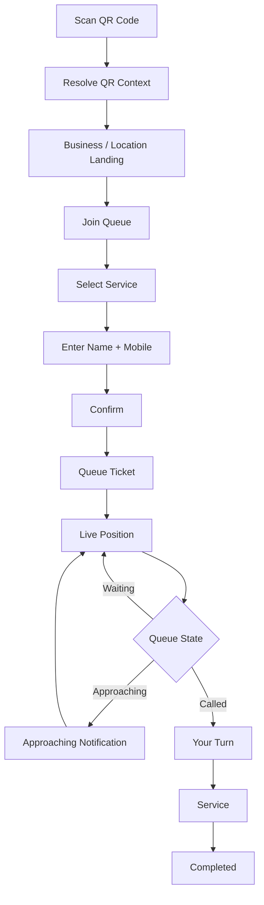
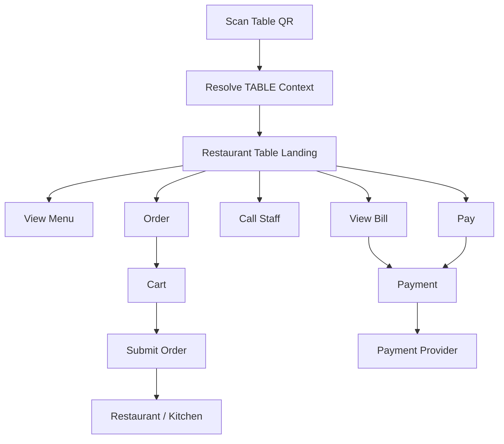
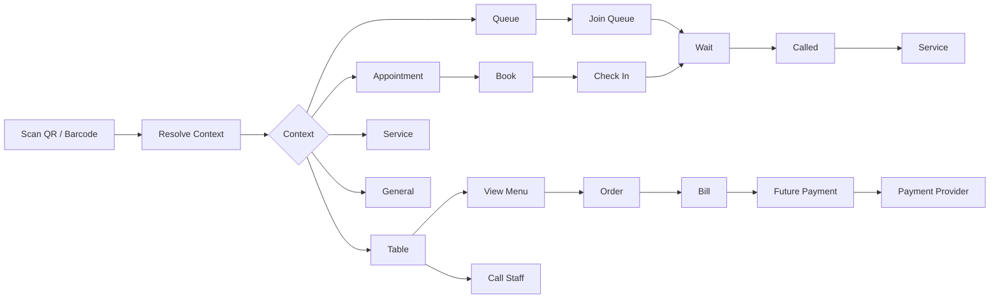

# QueueFlow — Visual Prototype & Screen Flow Guide

## Purpose

This document is a visual implementation guide for Codex/Claude Code.

QueueFlow should feel **modern, minimalist, calm, spacious, professional, and action-focused**.

There are three experiences:

1. Customer
2. Business/staff
3. Public display

They share the same design system but have different information density.

---

# 1. Visual Prototype


This image is a **visual reference**, not a pixel-perfect specification. Preserve its hierarchy, spacing, typography, colour restraint, card treatment and overall tone.

---

# 2. Visual Theme

## Design concept

### Calm Digital Concierge

QueueFlow should feel like a digital concierge rather than an old-fashioned queue-number system.

The interface should answer:

> **What can I do here?**

and, for staff:

> **What needs my attention now?**

## Brand message

Primary:

> **One QR. Many possibilities.**

Secondary:

> **Turn every space into a digital experience.**

This should work for queueing now and ordering, appointments and payments later.

---

# 3. Colour System

```text
Background       #F8F9FC
Surface          #FFFFFF
Primary text     #172033
Secondary text   #667085
Border           #E7EAF0
Primary accent   #5267E8
Accent hover     #4057D6
```

Semantic colours should be soft:

```text
Success  soft green
Warning  soft amber
Danger   muted red
Info     soft blue
```

Do not use saturated colours everywhere.

Indigo is primarily for:

- primary actions
- selected navigation
- links
- important status
- interactive highlights

---

# 4. Typography

Preferred:

```text
Inter
```

or:

```text
Geist
```

Fallback:

```text
system-ui
```

Suggested hierarchy:

```text
Hero             48–64px
Page heading     28–36px
Section heading  20–24px
Card heading     16–18px
Body             14–16px
Secondary        12–14px
```

Avoid tiny enterprise-dashboard text.

---

# 5. Spacing and Cards

Use a consistent scale:

```text
4  8  12  16  20  24  32  40  48  64
```

Cards:

```text
background: white
border: 1px solid #E7EAF0
border-radius: 12–16px
subtle shadow
```

Prefer whitespace over heavy borders.

---

# 6. Buttons

Primary:

```text
┌─────────────────────┐
│     CALL NEXT       │
└─────────────────────┘
```

Use the primary accent with white text.

Secondary buttons should be white with a light border.

Destructive actions use muted red.

Keep action hierarchy obvious; avoid many competing primary buttons.

---

# 7. Customer UX Principle

Customer UI should have almost no navigation.

The ideal pattern is:

```text
Context
   ↓
Available actions
   ↓
Action
   ↓
Result
```

The customer should not need an account just to join a queue.

---

# 8. Customer Queue Flow



---

# 9. Customer — QR Landing

```text
┌─────────────────────────────┐
│                             │
│          QueueFlow          │
│                             │
│       Joe's Barbers         │
│        Christchurch         │
│                             │
│  ┌───────────────────────┐  │
│  │   👥 Join the Queue   │  │
│  │   Get in line now     │  │
│  └───────────────────────┘  │
│                             │
│  ┌───────────────────────┐  │
│  │   📅 Appointment      │  │
│  │   Choose a time       │  │
│  └───────────────────────┘  │
│                             │
│          View Services      │
└─────────────────────────────┘
```

Use large touch targets and very little copy.

---

# 10. Customer — Service Selection

```text
┌─────────────────────────────┐
│ ← Join the Queue            │
│                             │
│ Select a service             │
│                             │
│ ┌─────────────────────────┐ │
│ │ ○ Haircut               │ │
│ │   ~25 minutes            │ │
│ └─────────────────────────┘ │
│                             │
│ ┌─────────────────────────┐ │
│ │ ● Haircut + Beard       │ │
│ │   ~40 minutes            │ │
│ └─────────────────────────┘ │
│                             │
│ ┌─────────────────────────┐ │
│ │ ○ Kids Haircut          │ │
│ │   ~20 minutes            │ │
│ └─────────────────────────┘ │
│                             │
│        [ Continue ]         │
└─────────────────────────────┘
```

---

# 11. Customer — Queue Confirmation

```text
┌─────────────────────────────┐
│             ✓               │
│                             │
│       You're in the queue!  │
│                             │
│             #42             │
│                             │
│       6 people ahead        │
│                             │
│      Estimated wait         │
│         ~35 mins            │
│                             │
│ ──────────────────────────  │
│ We'll text you when you're  │
│ getting close.              │
│                             │
│       [ View Queue ]        │
└─────────────────────────────┘
```

---

# 12. Customer — Live Queue

```text
┌─────────────────────────────┐
│ Joe's Barbers               │
│                             │
│       Your Queue Ticket     │
│                             │
│             #42             │
│                             │
│        3 people ahead       │
│        ~18 minutes          │
│                             │
│        ● ● ● ○ ○ ○          │
│                             │
│ Status: Waiting             │
│                             │
│ We'll let you know when     │
│ you're nearly next.         │
│                             │
│       [ Leave Queue ]       │
└─────────────────────────────┘
```

Position updates without page refresh.

---

# 13. Customer — Called

```text
┌─────────────────────────────┐
│                             │
│        You're next!         │
│                             │
│             #42             │
│                             │
│      Please proceed to      │
│          reception          │
│                             │
│       [ View Location ]     │
└─────────────────────────────┘
```

The called state should be visually prominent without being alarming.

---

# 14. Restaurant Table — Future Flow

The same QR infrastructure can resolve a table context.



Example:

```text
┌─────────────────────────────┐
│      Joe's Restaurant       │
│          Table 12           │
│                             │
│ ┌─────────────────────────┐ │
│ │ 🍽  View Menu           │ │
│ └─────────────────────────┘ │
│                             │
│ ┌─────────────────────────┐ │
│ │ 🛒  Order Food          │ │
│ └─────────────────────────┘ │
│                             │
│ ┌─────────────────────────┐ │
│ │ 🔔  Call Staff          │ │
│ └─────────────────────────┘ │
│                             │
│ ┌─────────────────────────┐ │
│ │ 💳  View / Pay Bill     │ │
│ └─────────────────────────┘ │
└─────────────────────────────┘
```

This is the core reason the QR system must be context-oriented rather than queue-oriented.

---

# 15. Business Dashboard

Desktop-first:

```text
┌────────────────────────────────────────────────────────────┐
│ QueueFlow                           Joe's Barbers     👤   │
├──────────────┬─────────────────────────────────────────────┤
│ Dashboard    │ Dashboard                                   │
│ Queue        │                                             │
│ Appointments │ ┌──────┐ ┌──────┐ ┌──────┐ ┌──────┐       │
│ Services     │ │  5   │ │  1   │ │  8   │ │ 18m  │       │
│ QR Codes     │ │Queue │ │Serve │ │Appts │ │Wait  │       │
│ Customers    │ └──────┘ └──────┘ └──────┘ └──────┘       │
│ Notifications│                                             │
│ Reports      │ Current Queue                              │
│ Settings     │ ┌─────────────────────────────────────────┐ │
│              │ │ 1 Alex T.    Haircut      NOW          │ │
│              │ │ 2 Jamie L.   Beard        ~10m         │ │
│              │ │ 3 Taylor M.  Haircut      ~20m         │ │
│              │ └─────────────────────────────────────────┘ │
│              │                                             │
│              │                [ CALL NEXT ]                │
└──────────────┴─────────────────────────────────────────────┘
```

The dashboard should answer:

1. How busy are we?
2. Who is waiting?
3. Who is being served?
4. What appointments are coming?
5. What needs action now?

---

# 16. Staff Queue Screen

```text
┌─────────────────────────────────────────────────────────┐
│ Queue                                      Open ●        │
│                                                         │
│ Current Queue                                            │
│                                                         │
│ ┌─────────────────────────────────────────────────────┐ │
│ │ #42  Alex T.     Haircut       NOW SERVING          │ │
│ ├─────────────────────────────────────────────────────┤ │
│ │ #43  Jamie L.    Beard         ~10 min              │ │
│ │ #44  Taylor M.   Haircut       ~20 min              │ │
│ │ #45  Casey R.    Kids Cut      ~30 min              │ │
│ └─────────────────────────────────────────────────────┘ │
│                                                         │
│                   [ CALL NEXT ]                         │
│                                                         │
│ Current: #42 Alex T.                                    │
│ [ Start ] [ Recall ] [ No Show ] [ Complete ]          │
└─────────────────────────────────────────────────────────┘
```

`CALL NEXT` is the primary operational action.

---

# 17. QR Management Screen

QR should be a first-class platform concept.

```text
┌──────────────────────────────────────────────────────────┐
│ QR Codes                                  [ + Create QR ] │
│                                                          │
│ Your physical QR experiences                             │
│                                                          │
│ ┌──────────────────────────────────────────────────────┐ │
│ │ [QR]  Main Entrance                                  │ │
│ │       QUEUE → Haircut                                │ │
│ │       Christchurch                       [ Manage ]  │ │
│ ├──────────────────────────────────────────────────────┤ │
│ │ [QR]  Reception                                      │ │
│ │       APPOINTMENTS                       [ Manage ]  │ │
│ ├──────────────────────────────────────────────────────┤ │
│ │ [QR]  Table 12                                       │ │
│ │       TABLE → Ordering                   [ Manage ]  │ │
│ └──────────────────────────────────────────────────────┘ │
└──────────────────────────────────────────────────────────┘
```

---

# 18. QR Context Editor

```text
┌───────────────────────────────────────────┐
│ QR Context                                │
│                                           │
│ Name                                      │
│ [ Main Entrance                         ] │
│                                           │
│ Location                                  │
│ [ Christchurch                          ▼] │
│                                           │
│ Context                                   │
│ [ Queue                                 ▼]│
│                                           │
│ Queue                                     │
│ [ Haircut Queue                         ▼]│
│                                           │
│ Available capabilities                    │
│ ☑ Join Queue                              │
│ ☑ Book Appointment                        │
│ ☐ View Menu                               │
│ ☐ Order                                   │
│ ☐ Call Staff                              │
│ ☐ Payment                                 │
│                                           │
│ [ Save ]                                  │
└───────────────────────────────────────────┘
```

The available capabilities should depend on context type.

---

# 19. Public Queue Display

Keep this extremely simple:

```text
┌──────────────────────────────────────────────────┐
│                                                  │
│              JOE'S BARBERS                      │
│                                                  │
│                 NOW SERVING                      │
│                                                  │
│                     #42                          │
│                                                  │
│                   ALEX T.                        │
│                                                  │
│                   Haircut                        │
│                                                  │
│             PLEASE PROCEED                      │
│                                                  │
│       Next: #43    #44    #45                    │
└──────────────────────────────────────────────────┘
```

Never show phone numbers or unnecessary PII.

---

# 20. Appointment Flow

```text
Select service
      ↓
Select date
      ↓
Select available time
      ↓
Enter details
      ↓
Confirm
      ↓
Appointment created
      ↓
Reminder
      ↓
Check in
      ↓
Queue
```

Example customer UI:

```text
┌─────────────────────────────┐
│ ← Appointment               │
│                             │
│ Choose a service            │
│ Haircut — 30 minutes        │
│                             │
│ Choose a date               │
│ S  M  T  W  T  F  S        │
│    28 29 30 1  2  3         │
│                             │
│ Available times             │
│ 9:00  9:30  10:00           │
│ 10:30 11:00 11:30           │
│                             │
│       [ Continue ]          │
└─────────────────────────────┘
```

---

# 21. Complete Platform Flow



---

# 22. Component Architecture

Suggested frontend structure:

```text
components/
├── ui/
│   ├── Button
│   ├── Card
│   ├── Input
│   ├── Badge
│   ├── Dialog
│   └── Toast
│
├── qr/
│   ├── QRCodeCard
│   ├── QRContextCard
│   ├── QRPreview
│   └── QRCapabilityList
│
├── queue/
│   ├── QueueStatus
│   ├── QueuePosition
│   ├── QueueEntryRow
│   ├── QueueList
│   ├── CallNextButton
│   └── QueueDisplay
│
├── appointments/
│   ├── AppointmentCard
│   ├── Calendar
│   └── TimeSlotPicker
│
└── layout/
    ├── CustomerLayout
    ├── AdminLayout
    └── DisplayLayout
```

Build the design system before implementing many screens.

---

# 23. Responsive Strategy

```text
Mobile:
< 640px

Tablet:
640–1024px

Desktop:
> 1024px

Large:
> 1440px
```

Customer:

> mobile-first

Business:

> desktop-first, responsive

Display:

> large-screen optimized

Do not force a desktop sidebar onto mobile customer experiences.

---

# 24. Accessibility

Target WCAG AA.

Include:

- keyboard navigation
- semantic HTML
- visible focus states
- accessible labels
- sufficient contrast
- screen-reader support
- large touch targets
- status that is not communicated by colour alone

---

# 25. Motion

Use subtle motion only:

- queue position changes
- success confirmation
- button feedback
- panel transitions
- toast notifications

Avoid excessive animation, bouncing, animated backgrounds and heavy transitions.

---

# 26. Empty States

Example queue:

```text
No one is waiting

Your queue is currently empty.

[ View QR Code ]
```

Example QR:

```text
No QR experiences yet

Create a QR code to connect
your physical space to QueueFlow.

[ Create QR ]
```

---

# 27. Error States

Prefer actionable language:

```text
Something went wrong

We couldn't load the queue.

[ Try Again ]
```

Never expose stack traces or technical errors to customers.

---

# 28. Design Tokens

Create shared design tokens instead of hardcoding styles.

```css
--color-bg: #f8f9fc;
--color-surface: #ffffff;
--color-text-primary: #172033;
--color-text-secondary: #667085;
--color-border: #e7eaf0;
--color-primary: #5267e8;

--radius-sm: 8px;
--radius-md: 12px;
--radius-lg: 16px;
```

Use the frontend framework's equivalent token system if preferable.

---

# 29. Iconography

Use one consistent outline icon library.

Recommended:

```text
Lucide
```

Avoid mixing multiple icon styles.

---

# 30. Do Not Do

```text
❌ Heavy gradients everywhere
❌ Neon colours
❌ Excessive glassmorphism
❌ Dense enterprise tables
❌ Tiny text
❌ Permanent desktop sidebar on mobile
❌ Too many dashboard cards
❌ Excessive animation
❌ Mandatory customer registration
❌ Public displays showing PII
❌ Queue-specific assumptions inside generic QR components
```

---

# 31. Implementation Rules for Codex / Claude

1. Read this document before implementing UI.
2. Treat the generated image as visual direction, not a pixel-perfect screenshot.
3. Build the design system first.
4. Create reusable components for cards, buttons, inputs, status badges, QR contexts, queue rows and appointments.
5. Build customer screens mobile-first.
6. Build staff/admin screens desktop-first.
7. Keep public display layouts separate.
8. Keep QR Context components generic.
9. Do not hard-code "queue" into generic QR components.
10. Do not implement ordering/payment in the MVP unless the active implementation phase requires it.
11. Every new screen should follow the same spacing, typography, colour and interaction system.
12. Perform responsive and accessibility checks for each completed screen.

---

# 32. Final UX Model

The fundamental UX model is:

```text
Physical Context
      ↓
Scan QR
      ↓
Resolve Context
      ↓
Show Available Capabilities
      ↓
One Simple Action
      ↓
Clear Result
```

Examples:

```text
Barber QR
→ Join Queue
→ Book Appointment

Restaurant Table QR
→ View Menu
→ Order
→ Call Staff
→ Pay

Service Desk QR
→ Join Queue
→ Book Appointment

Future Product QR
→ Product Information
→ Order
→ Support
```

The visual system should therefore communicate:

> **QueueFlow connects physical spaces to simple digital experiences.**

The QR Context Platform is the common foundation; queueing, appointments, ordering and payments are capabilities built on top of it.
